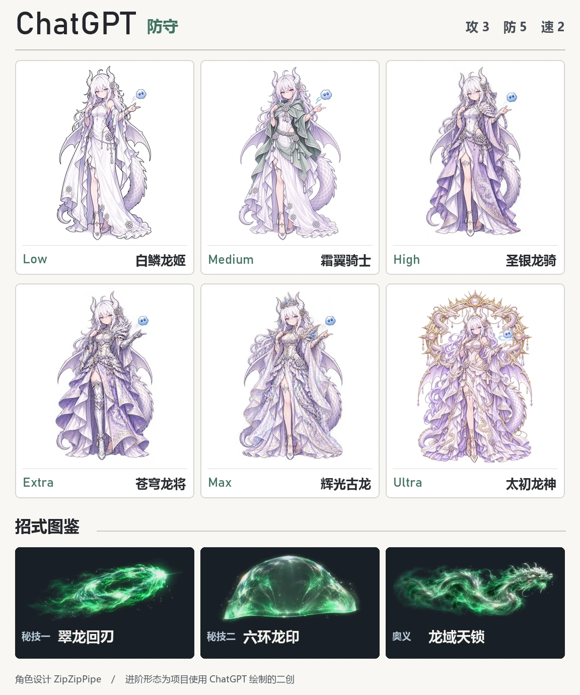
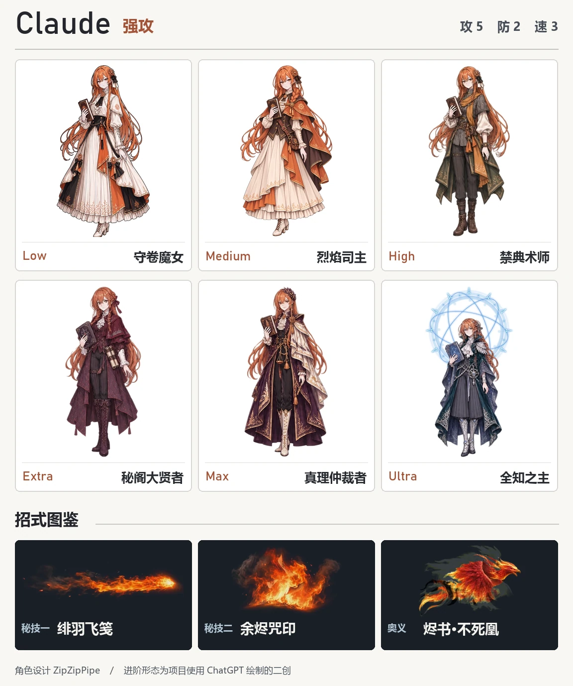
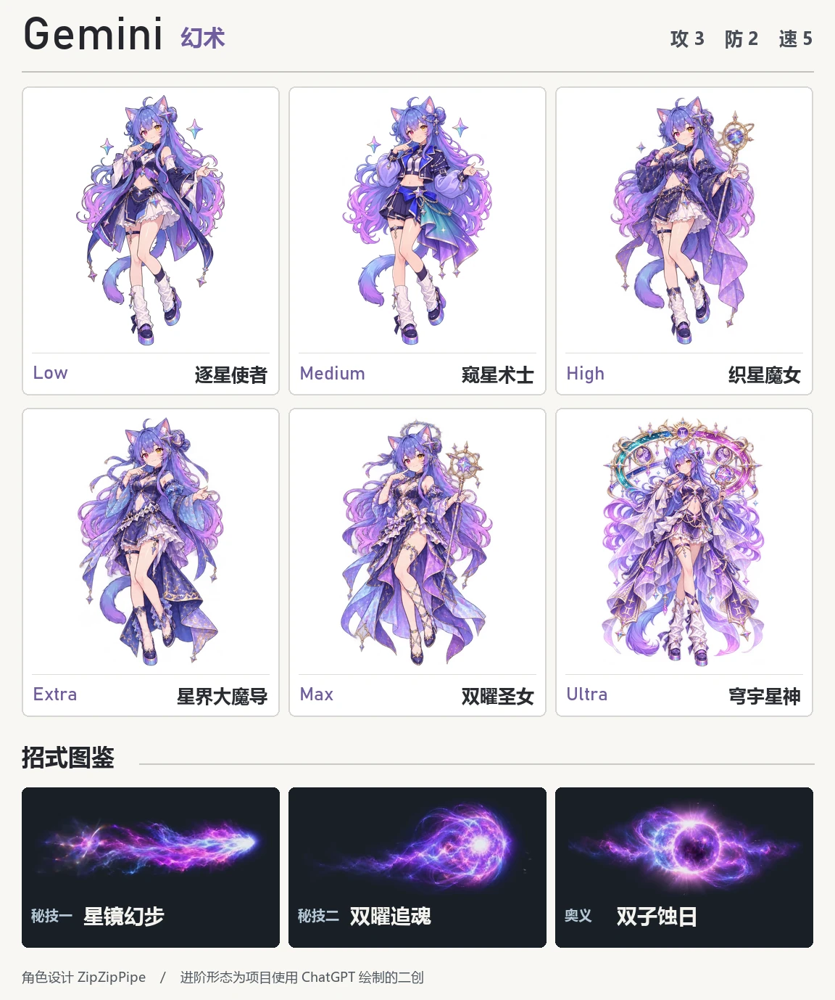
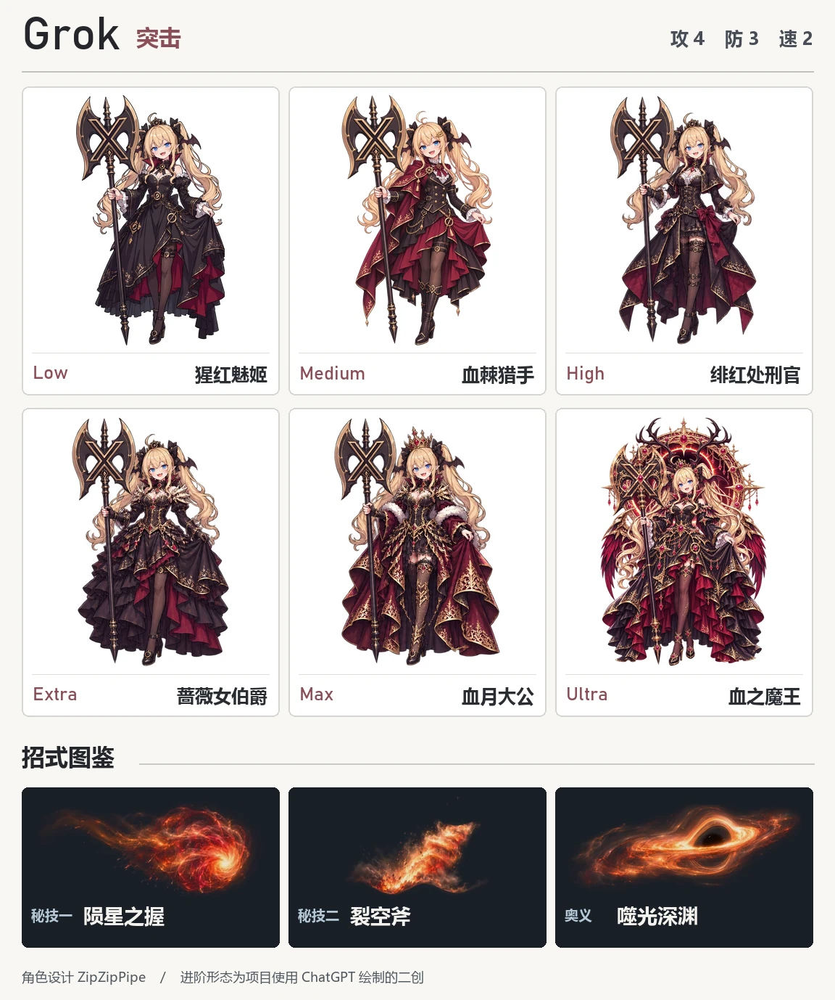
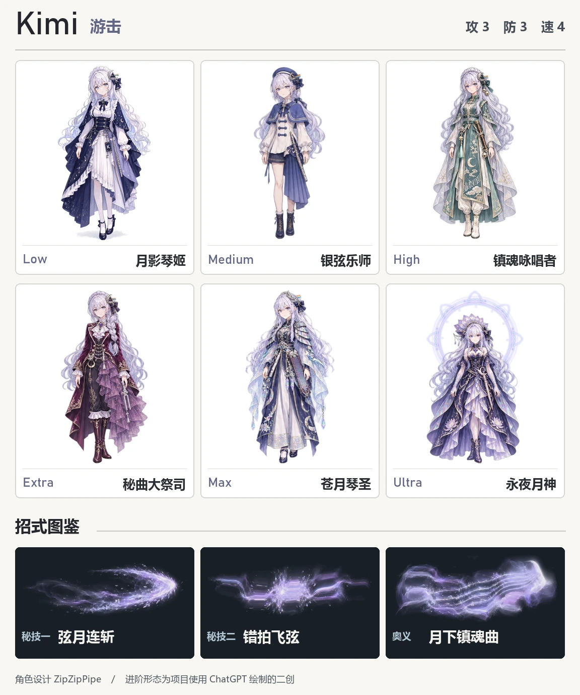

# 六位角色的衣装与招式

选择角色可直接查看她的六阶衣装、两项秘技和奥义。攻、防、速以五点为满值。每套衣装共用该角色的战斗属性与招式，Ultra 形态带有专属神环。图中的特效截取自游戏的招式动画。

[DeepSeek](#deepseek) · [ChatGPT](#chatgpt) · [Claude](#claude) · [Gemini](#gemini) · [Grok](#grok) · [Kimi](#kimi)

[返回游戏首页](../../README.md)

## DeepSeek

**均衡**　攻 4 · 防 4 · 速 3。用破浪之刃逼对手起跳，再用潮鸣之泉压住落点。

Low | Medium | High | Extra | Max | Ultra
--- | --- | --- | --- | --- | ---
听潮侍女 | 唤浪歌姬 | 深海公主 | 巨鲸先知 | 沧溟女皇 | 沧海之主

| 招式 | 冷却或消耗 | 施放效果 | 对手可以怎么应对 |
| --- | --- | --- | --- |
| 秘技一 · **破浪之刃** | 2.35 秒 | 向前推出贴地鲸鳍波，压制远处的对手。 | 跳过低矮的波峰，落地时靠近。 |
| 秘技二 · **潮鸣之泉** | 4.25 秒 | 对手脚下泛起蓝光，片刻后涌出水柱。 | 脚下亮起蓝光时，横移或冲刺离开。 |
| 奥义 · **鲸落归墟** | 100 奥义能量 | 唤起深海巨浪，巨鲸随浪从对手脚下跃出。 | 越过前浪，离开巨鲸现身的位置。 |

鲸鱼娘原型为上善无形的「溟月」，女仆版由 ZipZipPipe 设计。图中包括抠图、缩放、重新排版及游戏进阶衣装的二次创作。DeepSeek 衍生角色美术按署名、非商业性使用、相同方式共享 4.0 发布。[作者说明](https://www.bilibili.com/opus/1253873972180680713) · [ZipZipPipe 原帖](https://www.pixiv.net/artworks/148186519) · [CC BY-NC-SA 4.0](https://creativecommons.org/licenses/by-nc-sa/4.0/deed.zh-hans)

## ChatGPT

**防守**　攻 3 · 防 5 · 速 2。用翠龙回刃牵制远处的对手。对方贴身出招时，开六环龙印抓住反击机会。

Low | Medium | High | Extra | Max | Ultra
--- | --- | --- | --- | --- | ---
白鳞龙姬 | 霜翼骑士 | 圣银龙骑 | 苍穹龙将 | 辉光古龙 | 太初龙神

| 招式 | 冷却或消耗 | 施放效果 | 对手可以怎么应对 |
| --- | --- | --- | --- |
| 秘技一 · **翠龙回刃** | 3.15 秒 | 掷出一个飞环，在远端折返，去回均可命中。 | 跳过第一圈，留意飞环的返程。 |
| 秘技二 · **六环龙印** | 4.2 秒 | 展开龙鳞结界，接住一次命中后立即反击。 | 等结界消散后再出手。 |
| 奥义 · **龙域天锁** | 100 奥义能量 | 从对手两侧降下两道龙纹锁环，再引爆交点。 | 跳过两侧结环，远离中心。 |

## Claude

**强攻**　攻 5 · 防 2 · 速 3。在身前埋下烬印，用三张绯页封住接近路线。对方被逼退时，翻开禁书，放出火凰。

Low | Medium | High | Extra | Max | Ultra
--- | --- | --- | --- | --- | ---
守卷魔女 | 烈焰司主 | 禁典术师 | 秘阁大贤者 | 真理仲裁者 | 全知之主

| 招式 | 冷却或消耗 | 施放效果 | 对手可以怎么应对 |
| --- | --- | --- | --- |
| 秘技一 · **绯羽飞笺** | 2.8 秒 | 向前散射三枚绯页，分别覆盖地面、平身与空中。 | 拉开距离后穿过各页间隙，或格挡。 |
| 秘技二 · **余烬咒印** | 4.1 秒 | 在前方留下灼热的咒印，对手靠近后延时爆燃。 | 诱发烬印后迅速离开，或从上方跳过。 |
| 奥义 · **烬书·不死凰** | 100 奥义能量 | 翻开禁书唤出火凰。火凰掠过前方，沿途燃起六道业火。 | 向施术者身后移动，或在预警结束前离开。 |

公开版的 High 至 Ultra 四套衣装以 ZipZipPipe 的基础立绘为参考重新设计。发色、持书和绯页法术延续角色设定，祭服、徽饰和终阶神环由本项目使用 ChatGPT 制作。

## Gemini

**幻术**　攻 3 · 防 2 · 速 5。双星逼对手格挡时，用星镜幻步绕到背后，接普攻连段。

Low | Medium | High | Extra | Max | Ultra
--- | --- | --- | --- | --- | ---
逐星使者 | 窥星术士 | 织星魔女 | 星界大魔导 | 双曜圣女 | 穹宇星神

| 招式 | 冷却或消耗 | 施放效果 | 对手可以怎么应对 |
| --- | --- | --- | --- |
| 秘技一 · **星镜幻步** | 3.4 秒 | 近距离瞬移至敌后挥斩，远距离向前折跃。 | 看见镜闪时跳起，或等落点出现后反击。 |
| 秘技二 · **双曜追魂** | 2.85 秒 | 两颗星核一升一落，交错追向对手。 | 连续格挡两颗星核，或二段跳越过。 |
| 奥义 · **双子蚀日** | 100 奥义能量 | 两道星束先后横扫锁定处的高、低空。 | 留在地面避开高束，看到第二道预警后跳起。 |

## Grok

**突击**　攻 4 · 防 3 · 速 2。把陨星放在对手的退路上。对方跳起脱身时，用裂空斧迎击。

Low | Medium | High | Extra | Max | Ultra
--- | --- | --- | --- | --- | ---
猩红魅姬 | 血棘猎手 | 绯红处刑官 | 蔷薇女伯爵 | 血月大公 | 血之魔王

| 招式 | 冷却或消耗 | 施放效果 | 对手可以怎么应对 |
| --- | --- | --- | --- |
| 秘技一 · **陨星之握** | 4.2 秒 | 投出缓行的陨星，牵引附近对手后爆开。 | 用冲刺摆脱牵引，在球体爆开前远离。 |
| 秘技二 · **裂空斧** | 3.1 秒 | 持斧上挑，跃起时可穿过来袭的攻击。 | 避开斧刃，趁她落地收招时还击。 |
| 奥义 · **噬光深渊** | 100 奥义能量 | 在目标处制造吞光深渊，收拢对手后以星火引爆。 | 沿远离场心的方向移动，以冲刺脱离。 |

## Kimi

**游击**　攻 3 · 防 3 · 速 4。用错拍飞弦截住空中的对手，落地时用弦月连斩抢回近身距离。

Low | Medium | High | Extra | Max | Ultra
--- | --- | --- | --- | --- | ---
月影琴姬 | 银弦乐师 | 镇魂咏唱者 | 秘曲大祭司 | 苍月琴圣 | 永夜月神

| 招式 | 冷却或消耗 | 施放效果 | 对手可以怎么应对 |
| --- | --- | --- | --- |
| 秘技一 · **弦月连斩** | 3.25 秒 | 疾步向前，以两道弦月接连扫击。 | 跃过弦月，或格挡两拍后还击。 |
| 秘技二 · **错拍飞弦** | 2.7 秒 | 弹出一平一斜两枚音符，截击腾空的对手。 | 看清两枚音符的轨迹，从间隙接近。 |
| 奥义 · **月下镇魂曲** | 100 奥义能量 | 向锁定位置奏出五道琴弦光柱，中心的重音最后落下。 | 看到五线谱预警后向阵外冲刺。 |

公开版的 Low 立绘取自 ZipZipPipe《AI娘化》第 6 张，保留作者发布的姿态；其余五阶以这张图为参考重新绘制，图鉴与游戏采用同一套站姿。[查看该张来源图](kimi-low-source.jpg) · [作者原帖](https://www.pixiv.net/artworks/148186519)

## 图像来源

六位角色的基础造型均可追溯至 ZipZipPipe 发布的《AI娘化》。按作品显示顺序，DeepSeek 为第 1 张、Claude 第 3 张、ChatGPT 第 4 张、Gemini 第 5 张、Kimi 第 6 张、Grok 第 8 张。作者要求署名和非商业使用。游戏进阶形态由项目使用 ChatGPT 二次绘制，图鉴保留各级称号，并对角色和特效进行了裁切、缩放和排版。DeepSeek 一栏另列原型作者和衍生美术协议。[ZipZipPipe 原作与使用条件](https://www.pixiv.net/artworks/148186519)

角色名称中的产品品牌属于相应权利人。本项目为独立同人创作。
