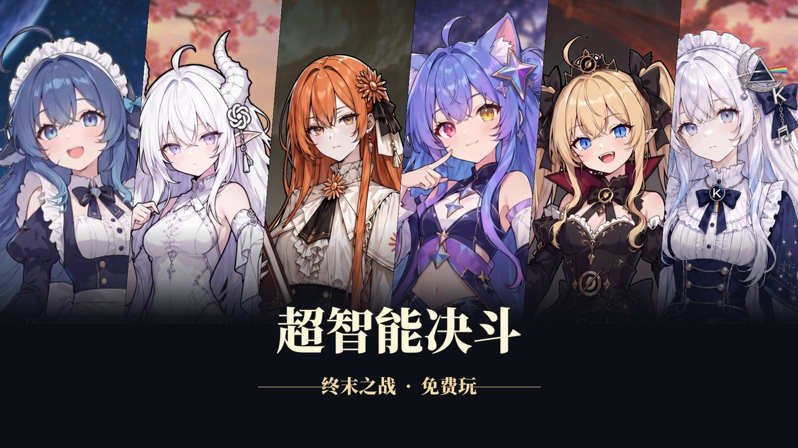

# 《超智能决斗 · 终末之战》公开版预告

[播放或下载预告片](trailer.mp4) · [免费玩](../../README.md)

全片约 32 秒。六位角色以基础形态登场后，DeepSeek 与 ChatGPT 先在星空交锋，再身披 Ultra 衣装踏入熔火铸庭。Claude 以 Low「守卷魔女」翻书召出火凤凰，Grok 挥斧迎战 Gemini，最后是 Gemini 与 Grok 的 Ultra 神环对决。

| 项目 | 制作与来源 |
| --- | --- |
| 游戏制作 | [@A1501314](https://github.com/A1501314) 发起《超智能决斗》，组织游戏设计、制作与公开发行。 |
| 角色设定与基础立绘 | ZipZipPipe《AI娘化》。群像镜头中的 Kimi 使用该图集第 6 张立绘。公开版对立绘进行了抠图、缩放、分镜和合成。[原作与使用条件](https://www.pixiv.net/artworks/148186519) |
| DeepSeek | 鲸鱼娘原型出自上善无形，ZipZipPipe 创作 DeepSeek 女仆版本，本片将其用于角色群像和实机演出。该角色改编素材按 CC BY-NC-SA 4.0 共享。[原型作者声明](https://www.bilibili.com/opus/1253873972180680713) · [许可全文](https://creativecommons.org/licenses/by-nc-sa/4.0/) |
| 进阶衣装 | 片中 DeepSeek、ChatGPT、Grok 与 Gemini 的进阶衣装，由项目发起人使用 ChatGPT 根据上述角色设定二次创作。 |
| 配乐 | 《六星入阵》，为本片编配和合成。弦乐、铜管、钟音与鼓点均由程序合成，配合凤凰和战斧的镜头切换。 |
| 声音 | **游戏人物声音为本项目原创设计。** 角色声音设定、台词与演绎设计由 @A1501314 负责。片中角色配音通过 BreezeBlue 合成，打击与战斗音效来自游戏程序。[BreezeBlue 使用条款](https://breezeblue.ai/zh/legal/terms) |

角色作品由原作者开放非商业使用。转发预告片请保留片尾署名和作品来源。各 AI 名称用于介绍非官方同人角色，品牌归各权利人所有。
